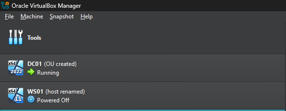
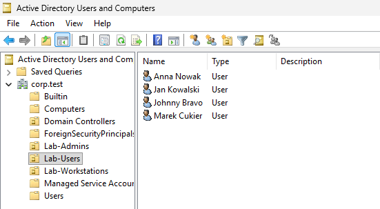
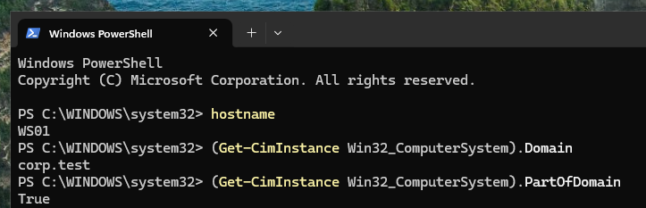

# On-Premises Infrastructure

## 1. Overview

The on-premises laboratory environment was deployed using Oracle VirtualBox. It consists of a Windows Server domain controller and a Windows 11 workstation connected through an isolated virtual network.

The environment uses Active Directory Domain Services (AD DS) for centralized identity management, authentication, and domain administration.

## 2. Virtual Machines

| Parameter | DC01 | WS01 |
|---|---|---|
| Operating System | Windows Server 2025 | Windows 11 Pro |
| Role | Domain Controller | Domain Workstation |
| vCPU | 2 | 3 |
| RAM | 4 GB | 6 GB |
| Disk | 80 GB | 100 GB |
| Hypervisor | Oracle VirtualBox | Oracle VirtualBox |

## 3. Network Configuration

The virtual machines communicate through an isolated VirtualBox Internal Network named `lab-ad`.

The domain controller uses an additional NAT adapter to provide outbound internet connectivity.

| Parameter | DC01 | WS01 |
|---|---|---|
| IPv4 Address | 10.10.10.1 | 10.10.10.20 |
| Subnet Mask | 255.255.255.0 | 255.255.255.0 |
| DNS Server | 10.10.10.1 | 10.10.10.1 |
| Network | Internal + NAT | Internal |

The domain controller provides DNS resolution for the `corp.test` domain. The workstation uses DC01 as its DNS server.

## 4. Active Directory Configuration

Active Directory Domain Services and DNS Server roles were installed on DC01.

| Parameter | Value |
|---|---|
| Domain Name | corp.test |
| Domain Controller | DC01 |
| DNS Server | 10.10.10.1 |

The following Organizational Units (OUs) were created:

| Organizational Unit | Purpose |
|---|---|
| Lab-Users | Standard domain user accounts |
| Lab-Admins | Administrative test accounts |
| Lab-Workstations | Domain-joined workstations |

Test accounts were created to represent standard domain users and administrative identities.

| Account | Organizational Unit | Purpose |
|---|---|---|
| j.kowalski | Lab-Users | Standard user |
| a.nowak | Lab-Users | Standard user |
| j.bravo | Lab-Users | Standard user |
| m.cukier | Lab-Users | Standard user |
| lab.admin | Lab-Admins | Administrative test account |

The Windows 11 workstation was joined to the `corp.test` domain and placed in the `Lab-Workstations` OU.

## 5. Verification

The deployment was verified by checking:

- DNS name resolution between the workstation and domain controller.
- Domain membership of the workstation.
- Availability of Active Directory Domain Services.
- Successful authentication using domain user accounts.
- Presence of the configured OUs and computer accounts in Active Directory.

## 6. Evidence

Screenshots documenting the environment:

- VirtualBox virtual machine configuration.

- Active Directory organizational structure.

- Domain membership verification.

