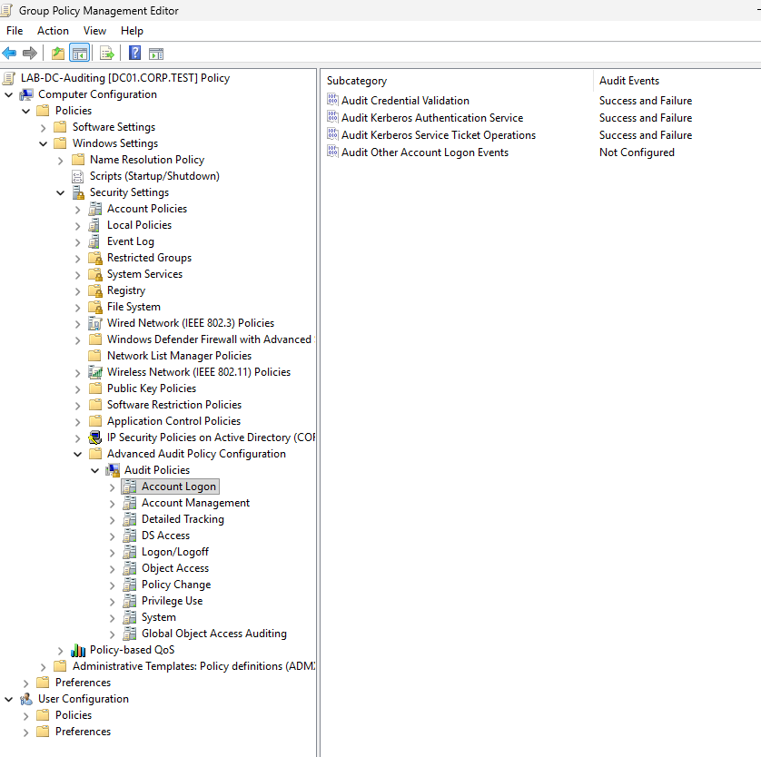
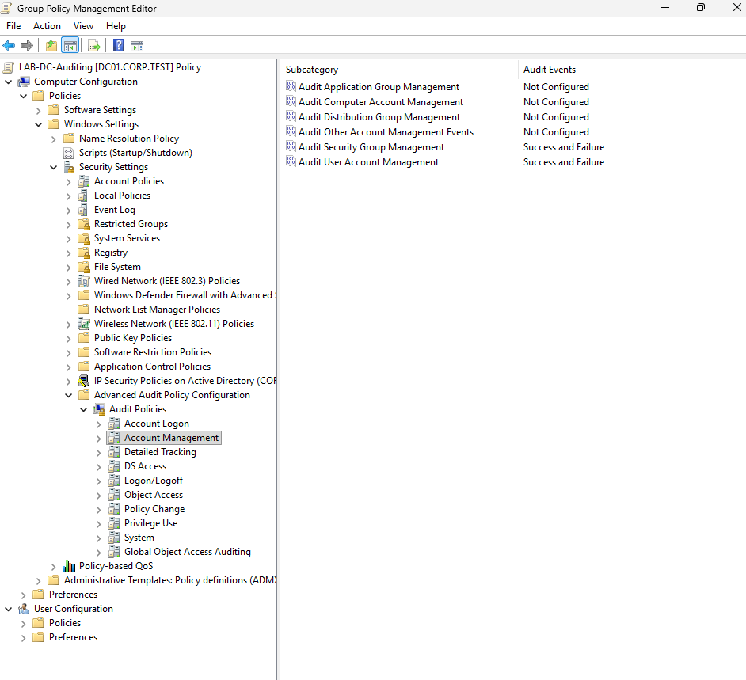
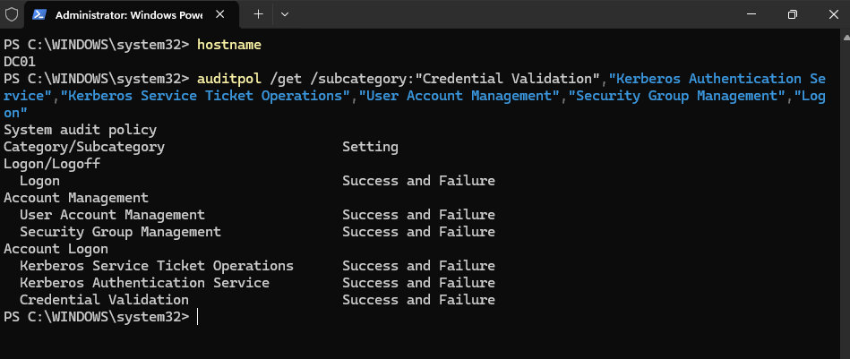
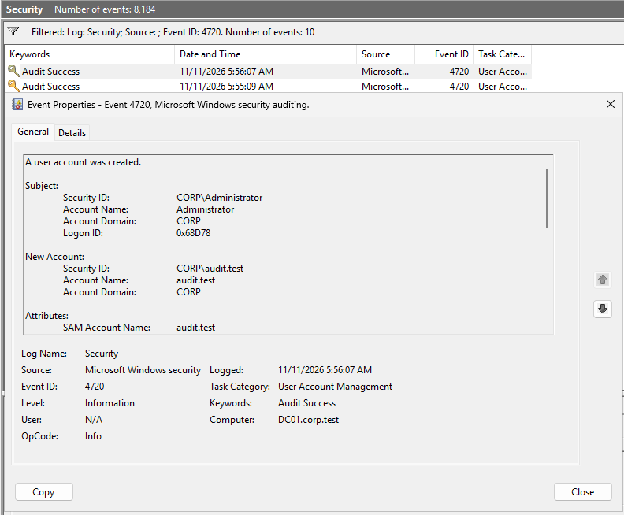

# Active Directory Security Auditing
## 1. Overview
Security auditing is configured on the domain controller (DC01) using a dedicated Group Policy Object (GPO). The policy records selected authentication events and changes to domain user accounts and security groups in the Windows Security event log.

## 2. Group Policy Configuration
| Parameter | Value |
|---|---|
| Domain | `corp.test` |
| Domain controller | `DC01` |
| GPO | `LAB-DC-Auditing` |
| Linked OU | `Domain Controllers` |

The following security option is enabled to give advanced audit subcategory settings precedence over legacy category-level audit settings:

| Category | Audit subcategory | Setting |
|---|---|---|
| Account Logon | Credential Validation | Success and Failure |
| Account Logon | Kerberos Authentication Service | Success and Failure |
| Account Logon | Kerberos Service Ticket Operations | Success and Failure |
| Account Management | User Account Management | Success and Failure |
| Account Management | Security Group Management | Success and Failure |
| Logon/Logoff | Logon | Success and Failure |

The following security option is enabled to give advanced audit subcategory settings precedence over legacy category-level audit settings:

`Audit: Force audit policy subcategory settings (Windows Vista or later) to override audit policy category settings`

## 3. Relevant Windows Security Events

| Event ID | Description | Audit subcategory |
|---|---|---|
| 4625 | Failed logon attempt |
| 4720 | A user account was created | User Account Management |
| 4728 | A member was added to a security-enabled global group | Security Group Management |
| 4769 | A Kerberos service ticket was requested | Kerberos Service Ticket Operations |
| 4771 | Kerberos pre-authentication failed | Kerberos Authentication Service |
| 4776 | The domain controller attempted to validate credentials | Credential Validation |

Event generation depends on the activity performed and the authentication protocol used. Enabling a policy does not guarantee that every listed event will appear without the corresponding activity.

## 4. Configuration Verification
After applying the GPO, effective audit settings can be inspected on DC01 using:

```
gpupdate /force
gpresult /r /scope computer
auditpol /get /category:*
```

Test operations for verifying security event collection:
- Event 4720: Create a test domain user account named audit.test in Lab-Users.
- Event 4728: Add audit.test to a test security-enabled global group named LAB-Audit-Test.

The resulting records can be inspected in `Event Viewer > Windows Logs > Security`, filtered by event ID. The Event Viewer record should show the operation, target account or group, and timestamp.

## 5. Evidence
- GPO - Account Logon



- GPO - Account Management



- Effective Audit Policy



- Account Creation - Event 4720


