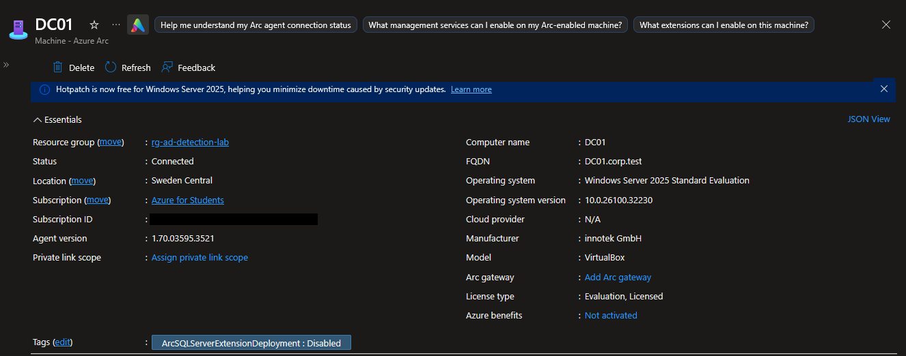
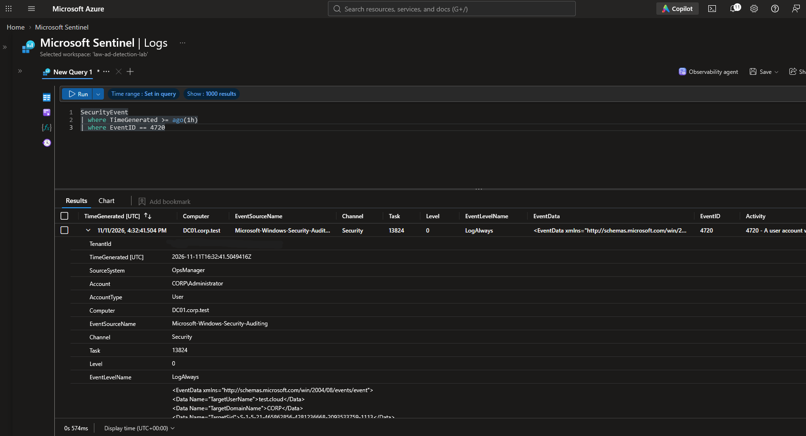

# Azure Integration

## 1. Overview

The on-premises Active Directory environment is integrated with Microsoft Azure to enable centralized security event collection and monitoring.

The domain controller DC01 is connected to Azure using Azure Arc. Windows security events are collected by Azure Monitor Agent (AMA) and forwarded to a Log Analytics Workspace, where they can be analyzed using Kusto Query Language (KQL) and Microsoft Sentinel.

## 2. Azure Resources

The following Azure resources are used in the laboratory:

| Resource | Name |
|---|---|
| Subscription | Azure for Students |
| Resource Group | rg-ad-detection-lab |
| Azure Arc Machine | DC01 |
| Log Analytics Workspace | law-ad-detection-lab |
| Data Collection Rule | dcr-ad-security-events |
| Monitoring Agent | Azure Monitor Agent |
| SIEM | Microsoft Sentinel |

## 3. Azure Arc Configuration

The on-premises domain controller DC01 was onboarded to Azure Arc using Azure Connected Machine Agent.

Azure Arc enables the local Windows Server to be managed as an Azure resource without migrating the virtual machine to the cloud.

The agent establishes an outbound HTTPS connection to Azure.

## 4. Log Collection

Windows security events are collected using Azure Monitor Agent installed on DC01.

A Data Collection Rule (DCR) named `dcr-ad-security-events` defines which events are collected and forwarded to the Log Analytics Workspace.

The rule is associated with DC01 through a Data Collection Rule Association (DCRA).

### Collected Security Events

| Event ID | Description |
|---|---|
| 4625 | Failed logon attempt |
| 4720 | User account creation |
| 4728 | Member added to a security-enabled global group |
| 4769 | Kerberos service ticket request |
| 4771 | Kerberos pre-authentication failure |
| 4776 | NTLM credential validation |

The following XPath filter is used to collect selected events:

```xml
Security!*[System[(EventID=4625 or EventID=4720 or EventID=4728 or EventID=4769 or EventID=4771 or EventID=4776)]]
```

Collecting only selected events reduces unnecessary log ingestion and helps control Azure costs.

## 5. Log Analytics Verification

The integration was verified by checking agent connectivity and querying Windows security events in Log Analytics.

The `Heartbeat` table confirmed communication between Azure Monitor Agent and the Log Analytics Workspace.

The following KQL query was used to verify collected security events:

```kql
SecurityEvent
| where TimeGenerated > ago(6h)
| where Computer contains "DC01"
| summarize EventCount = count() by EventID
| order by EventCount desc
```

Security events were successfully received from DC01, including:

- **4720** - User account creation
- **4769** - Kerberos service ticket request
- **4776** - NTLM credential validation

The successful collection of Event ID 4720 confirmed that Active Directory account management events are forwarded from the on-premises domain controller to Azure.

## 6. Evidence

- The domain controller DC01 registered as an Azure Arc-enabled server.



- Windows Security event 4720 collected from DC01 and queried using KQL.


