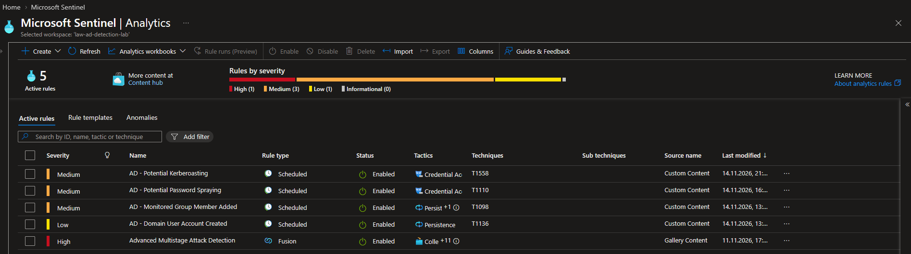
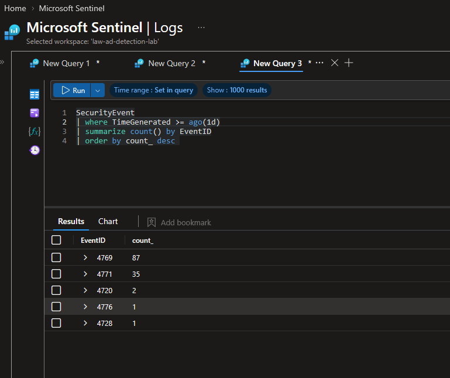
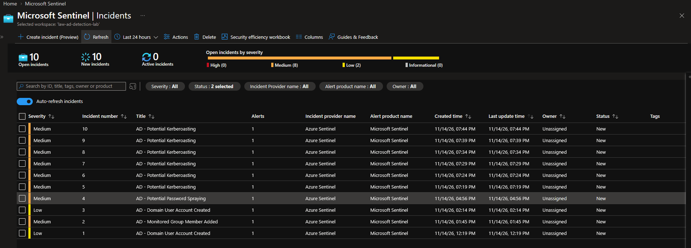

# Detection Rules - Microsoft Sentinel
## 1. Overview
This phase implements four Microsoft Sentinel scheduled analytics rules for detecting selected security-relevant activities in the simulated Active Directory environment. The rules process Windows Security events generated by the domain controller DC01 and forwarded to the Log Analytics workspace through Azure Arc, Azure Monitor Agent (AMA), and a Data Collection Rule (DCR).

The detection logic is written in Kusto Query Language (KQL).

The laboratory uses the following Azure resources:
| Resource | Value |
|---|---|
| Resource group | rg-ad-detection-lab |
| Log Analytics workspace | law-ad-detection-lab |
| Monitored domain controller | DC01.corp.test |
| Test workstation | WS01 (10.10.10.20) |


## 2. Implemented Detection Rules
| Detection	Windows | Event ID | MITRE ATT&CK | Severity | Bicep template |
|---|---|---|---|---|
| Domain account creation | 4720 | T1136.002 - Domain Account | Low | account-creation.bicep |
| Monitored group membership change | 4728 | T1098 - Account Manipulation | Medium | privileged-group-change.bicep |
| Potential password spraying | 4771, 4776 | T1110.003 - Password Spraying | Medium | password-spraying.bicep |
| Potential Kerberoasting | 4769 | T1558.003 - Kerberoasting | Medium | kerberoasting.bicep |


### 2.1. Domain Account Creation
Rule: AD - Domain User Account Created

This rule detects the creation of a domain user account using Event ID 4720. Each matching event can produce an alert. Account creation is not necessarily malicious; the rule provides visibility into an activity that could be associated with persistence.

### 2.2. Monitored Group Membership Change
Rule: AD - Monitored Group Member Added

This rule monitors Event ID 4728, which records the addition of a member to a security-enabled global group. It filters for selected groups, including Domain Admins and the laboratory group LAB-Audit-Test. The laboratory group is used for safe functional testing and is not itself privileged.

The rule does not cover every type of group membership change. For example, additions to universal or domain-local security groups use different event IDs.

### 2.3. Potential Password Spraying
Rule: AD - Potential Password Spraying

The rule analyzes failed authentication events:
- 4771: Kerberos pre-authentication failures, with status 0x18.
- 4776: NTLM credential validation failures, with status 0xC000006A.
The KQL query identifies the source of each attempt, groups events by source, event ID, and a fixed 30-minute time bucket, and counts distinct targeted accounts. It returns a result when at least three distinct accounts have failed authentication from the same source in the same bucket. This deliberately low threshold is suitable for the small test domain, not a general production recommendation.

### 2.4. Potential Kerberoasting
Rule: AD - Potential Kerberoasting

The rule analyzes successful Event ID 4769 requests for Kerberos service tickets (TGS). It looks for Ticket Encryption Type 0x17 (RC4-HMAC) and excludes selected system or machine accounts. One matching service-ticket request is sufficient to produce a query result: obtaining a single ticket can provide material for an offline password-cracking attempt.

The rule extracts TicketEncryptionType, ServiceName, and the result code from the XML-formatted EventData field. This was necessary because ServiceName was empty in the corresponding SecurityEvent column in the laboratory.

RC4 usage alone does not prove Kerberoasting. Legitimate requests may use RC4, and Kerberoasting can also involve AES-encrypted tickets. The implemented rule detects a specific suspicious indicator rather than every possible variant of the attack.

## 3. Scheduled Rule Configuration
All four detections use the Scheduled analytics rule type.

| Setting | Configured value |
|---|---|
| Query frequency | PT15M (every 15 minutes) |
| Query period | PT1H (last 1 hour) |
| Trigger operator | GreaterThan |
| Trigger threshold | 0 query results (at least one result to trigger alert) |
| Event grouping | AlertPerResult |
| Alert suppression | Disabled |
| Automatic incident creation | Enabled |
| Incident grouping | Disabled in the rule configuration |


The one-hour lookback allows for delays between event generation on DC01 and ingestion into Log Analytics. During initial validation, an ingestion delay of approximately 17 minutes was observed for an account creation event.

The KQL queries also use ingestion_time() or the maximum ingestion time in an aggregated group to focus on recently ingested events. These conditions help limit repeated alerts from overlapping query windows. However, fixed time buckets and ingestion-time filters may cause missed or repeated detections under some timing conditions; these are limitations to evaluate during the experiments.

The alert threshold of 0 refers to the number of rows returned by KQL. It is separate from the Password Spraying condition requiring at least three distinct accounts, which is implemented inside the query.

## 4. Bicep Deployment
The following files are stored in the project repository:
infrastructure/azure/rules/
- account-creation.bicep
- privileged-group-change.bicep
- password-spraying.bicep
- kerberoasting.bicep

Each file is self-contained and embeds its KQL query directly in the Bicep query property.

To deploy a rule, upload its Bicep file to Azure Cloud Shell (Bash), then run the commands from the directory containing that file:
```
az deployment group create \
  --resource-group rg-ad-detection-lab \
  --template-file password-spraying.bicep
  ```
Replace the template filename to deploy the other rules. Redeploying a template with the same resource name updates the existing rule.

After deployment, verify the analytics rules with Azure CLI:

```
SUB_ID=$(az account show --query id -o tsv)
az rest --method get \
  --url "https://management.azure.com/subscriptions/$SUB_ID/resourceGroups/rg-ad-detection-lab/providers/Microsoft.OperationalInsights/workspaces/law-ad-detection-lab/providers/Microsoft.SecurityInsights/alertRules?api-version=2025-09-01" \
  --query "value[].{Name:properties.displayName,Enabled:properties.enabled,Frequency:properties.queryFrequency,Period:properties.queryPeriod}" \
  -o table
  ```

or using the GUI (Microsoft Sentinel > Configuration > Analytics):


## 5. Functional Verification
Functional verification checks the pipeline in sequence:
1. Generate a controlled activity in the laboratory.
2. Confirm its Windows Security event on DC01.
3. Confirm the event is ingested into the Log Analytics `SecurityEvent` table.
4. Check that the deployed KQL matches the event.
5. Confirm alert generation in SecurityAlert or the Microsoft Sentinel interface.

The following table distinguishes deployed rules from confirmed alert-generation tests.

| Detection | Verification activity | Observed result |
|---|---|---|
| Account Creation | Create a test domain user; check Event ID 4720 | Alert confirmed |
| Group Membership Change | Add a test user to a monitored global group; check Event ID 4728 | Alert confirmed |
| Password Spraying | Failed authentication attempts from WS01 against multiple domain accounts | Alert confirmed |
| Kerberoasting | Request an RC4-encrypted service ticket for the test SPN | Alert confirmed |

## 6. Limitations
The rules are intended for a small, controlled laboratory. Important limitations include:
- The Account Creation rule may alert on legitimate administrative work.
- The group membership rule monitors selected global security groups, not every AD group change.
- Password Spraying requires at least three distinct accounts within a fixed 30-minute bucket; low-and-slow attacks or attempts spanning bucket boundaries may not match.
- The Password Spraying rule treats Kerberos and NTLM events separately and has been functionally confirmed for Kerberos failures only.
- The Kerberoasting rule detects successful RC4 service-ticket requests but may miss AES-based Kerberoasting and may alert on legitimate RC4 usage.
- Log ingestion latency, scheduled execution, and temporal query filters affect when alerts appear and whether a test is detected.
- Only the events collected from DC01 are included in the current detection scope; failures logged exclusively on WS01 are outside that scope.

## 7. Evidence
- Security events from DC01 existing in Azure Log Analytics Workspace (LAW)



- Sentinel que with generated incidents:




