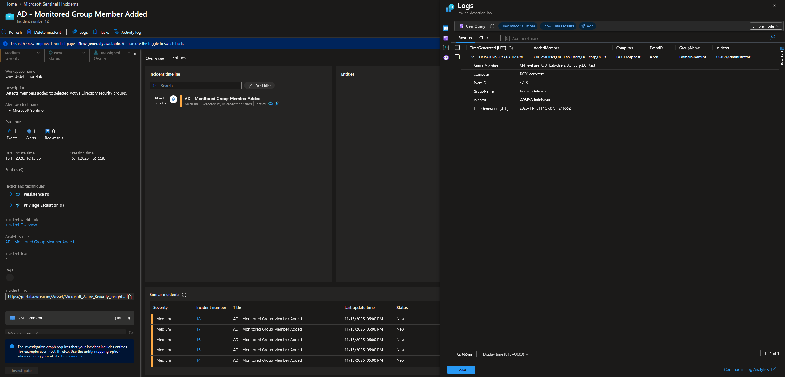
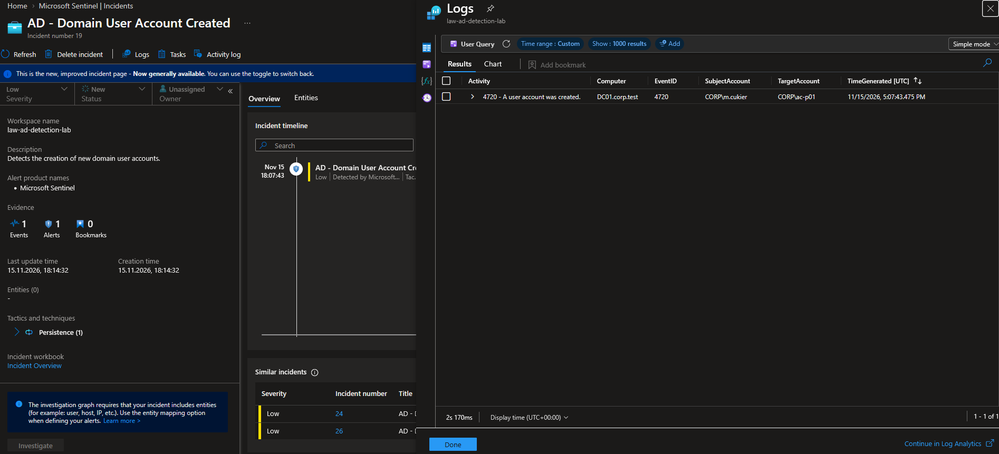
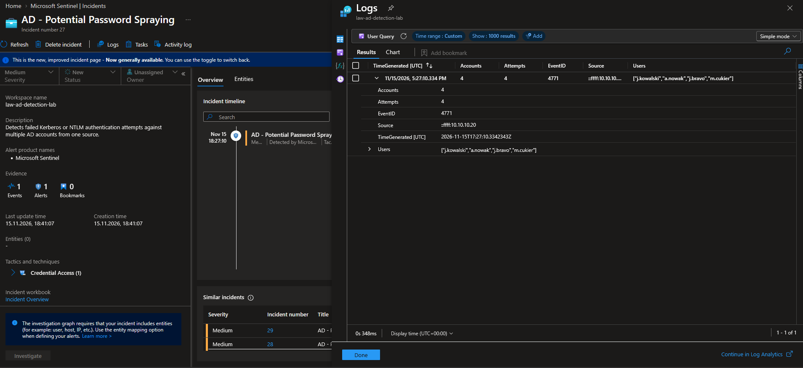
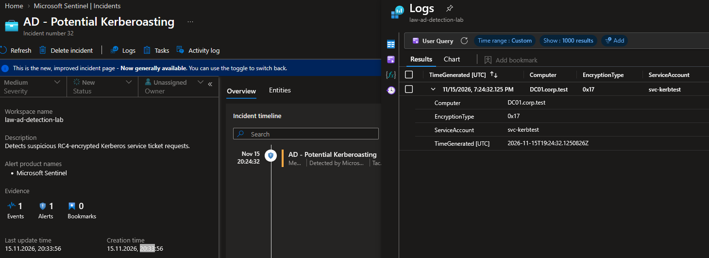

# Detection Experiments - Results

## 1. Overview

This document contains the results of controlled security experiments conducted in the Active Directory detection laboratory.

The experiments evaluate four Microsoft Sentinel analytics rules:

- Group Membership Change (T1098)
- Account Creation (T1136.002)
- Password Spraying (T1110.003)
- Kerberoasting (T1558.003)

Each scenario consists of five positive trials and three control trials (simulated authorized use), resulting in 32 planned experiments.

All timestamps are recorded in UTC.

## 2. Experiment Summary

### 2.1. Group Membership Change

| Test ID | Trial Type | Target group | User added | Event UTC | Ingestion UTC | Alert UTC | Result |
|---|---|---|---|---|---|---|---|
| GM-P01 | Positive | Domain Admins | e.user | 14:57 | 14:57 | 15:15 | TP |
| GM-P02 | Positive | Domain Admins | m.cukier | 14:58 | 14:58 | 15:15 | TP |
| GM-P03 | Positive | LAB-Audit-test | e.user | 16:18 | 16:19 | 16:30 | TP |
| GM-P04 | Positive | LAB-Audit-test | j.kowalski | 16:42 | 16:42 | 17:00 | TP |
| GM-P05 | Positive | Domain Admins | a.nowak | 16:43 | 16:44 | 17:00 | TP |
| GM-C01 | Control | Domain Admins | lab.admin | 16:50 | 16:51 | 17:00 | FP |
| GM-C02 | Control | LAB-Audit-test | j.bravo | 16:52 | 16:53 | 17:00 | FP |
| GM-C03 | Control | DNS Admins | a.nowak | 16:52 | 16:53 | 17:00 | TN |

### 2.2. Account Creation

| Test ID | Trial Type | Target | Event UTC | Ingestion UTC | Alert UTC | Result |
|---|---|---|---|---|---|---|
| AC-P01 | Positive | ac-p01 | 17:07 | 17:08 | 17:14 | TP |
| AC-P02 | Positive | ac-p02 | 17:09 | 17:10 | 17:29 | TP |
| AC-P03 | Positive | ac-p03 | 17:09 | 17:10 | 17:29 | TP |
| AC-P04 | Positive | ac-p04 | 17:10 | 17:11 | 17:29 | TP |
| AC-P05 | Positive | ac-p05 | 17:11 | 17:11 | 17:29 | TP |
| AC-C01 | Control | b.marlone | 17:12 | 17:13 | 17:29 | FP |
| AC-C02 | Control | m.zebra | 17:13 | 17:14 | 17:29 | FP |
| AC-C03 | Control | m.zebra > renamed to: j.polak | 17.17 | - | - | TN |

### 2.3. Password Spraying

| Test ID | Trial Type | Target | Event UTC | Ingestion UTC | Alert UTC | Result |
|---|---|---|---|---|---|---|
| PS-P01 | Positive | j.kowalski, a.nowak, j.bravo, m.cukier | 17:26 | 17:39 | 17:41 | TP |
| PS-P02 | Positive | j.kowalski, a.nowak, j.bravo | 17:50 | 18:39 | 18:41 | TP |
| PS-P03 | Positive | a.nowak, j.bravo, m.cukier | 18:53 | 18:54 | 19:11 | TP |
| PS-P04 | Positive | j.kowalski, j.bravo, m.cukier | 19:20 | 19:22 | 19:41 | TP |
| PS-P05 | Positive | j.kowalski, a.nowak, lab.admin | 19:50 | 19:51 | 20:11 | TP |
| PS-C01 | Control | j.kowalski | 20:20 | 20:21 | - | TN |
| PS-C02 | Control | a.nowak, j.bravo | 20:50 | 20:51 | - | TN |
| PS-C03 | Control | j.kowalski, j.bravo, m.cukier | 21:30 | 21:31 | 21:41 | FP |

### 2.4. Kerberoasting

| Test ID | Trial Type | Target | Event UTC | Ingestion UTC | Alert UTC | Result |
|---|---|---|---|---|---|---|
| KR-P01 | Positive | svc-kerbtest | 19:24 | 19:24 | 19:33 | TP |
| KR-P02 | Positive | svc-kerbtest | 20:33 | 20:34 | 20:39 | TP |
| KR-P03 | Positive | svc-kerbtest | 20:34 | 20:34 | 20:39 | TP |
| KR-P04 | Positive | svc-kerbtest | 20:34 | 20:36 | 20:39 | TP |
| KR-P05 | Positive | svc-kerbtest | 20:40 | 20:41 | 20:54 | TP |
| KR-C01 | Control | svc-kerbtest (authorized RC4) | 20:43 | 20:44 | 20:54 | FP |
| KR-C02 | Control | LDAP/DC01.corp.test (AES) | 21:13 | 21:14 | - | TN |
| KR-C03 | Control | CIFS/DC01.corp.test (DC01$) | 21:14 | 21:15 | - | TN |

---

## 3. Detailed Experiment Log

This section documents one representative experiment for each detection scenario. The remaining positive and control trials follow the same methodology and are recorded in the corresponding experiment summary tables.

Each experiment includes the executed action, expected security event, detection evidence, and observed result.

### 3.1. GM-P01 - Group Membership Change

**Objective:** Verify whether Microsoft Sentinel detects the addition of a user to a monitored Active Directory security group.

| Parameter | Value |
|---|---|
| Test ID | GM-P01 |
| Trial type | Positive |
| MITRE ATT&CK | T1098 |
| Host | DC01 |
| Target group | `Domain Admins` |
| Target account | `e.user` |
| Event ID | 4728 |
| Sentinel rule | AD - Monitored Group Member Added |
| Classification | TP |

**Executed command:**

```powershell
Add-ADGroupMember -Identity "LAB-Audit-Test" -Members "e.user"
```

The target user must not already be a member of the group before the operation.

**Evidence:**

- Microsoft Sentinel alert generated by the `AD - Monitored Group Member Added` detection rule.



---

### 3.2. AC-P01 - Account Creation

**Objective:** Verify whether Microsoft Sentinel detects the creation of a new domain user account.

| Parameter | Value |
|---|---|
| Test ID | AC-P01 |
| Trial type | Positive |
| MITRE ATT&CK | T1136.002 |
| Host | DC01 |
| Target account | `ac-p01` |
| Action | Create disabled domain user |
| Event ID | 4720 |
| Sentinel rule | AD - Domain User Account Created |
| Classification | TP |

**Executed command:**

```powershell
New-ADUser -Name "ac-p01" -SamAccountName "ac-p01" -Path "OU=Lab-Users,DC=corp,DC=test" -Description "Experiment AC-P01" -Enabled $false
```

**Expected evidence:**

- Microsoft Sentinel alert generated by the `AD - Domain User Account Created` detection rule.



---

### 3.3. PS-P01 - Password Spraying

**Objective:** Verify whether Microsoft Sentinel identifies multiple failed authentication attempts targeting different domain accounts from a single source.

| Parameter | Value |
|---|---|
| Test ID | PS-P01 |
| Trial type | Positive |
| MITRE ATT&CK | T1110.003 |
| Source host | WS01 (`10.10.10.20`) |
| Target accounts | `j.kowalski`, `a.nowak`, `j.bravo`, `m.cukier` |
| Event ID | 4771 |
| Failure code | `0x18` |
| Detection threshold | At least 3 distinct accounts within 30 minutes |
| Sentinel rule | AD - Potential Password Spraying |
| Event time (UTC) | 17:26 |
| Ingestion time (UTC) | 17:39 |
| Alert time (UTC) | 17:41 |
| Ingestion delay | Approximately 13 minutes |
| Detection latency | Approximately 15 minutes |
| Classification | TP |

**Executed commands:**

```cmd
runas /user:CORP\j.kowalski cmd
runas /user:CORP\a.nowak cmd
runas /user:CORP\j.bravo cmd
runas /user:CORP\m.cukier cmd
```

An intentionally incorrect password was entered for each account.

**Evidence:**

- Microsoft Sentinel alert `AD - Potential Password Spraying`.



---

### 3.4. KR-P01 - Kerberoasting

**Objective:** Verify detection of a Kerberos service ticket request using RC4-HMAC encryption.

| Parameter | Value |
|---|---|
| Test ID | KR-P01 |
| Trial type | Positive |
| MITRE ATT&CK | T1558.003 |
| Source host | WS01 |
| Service account | `svc-kerbtest` |
| SPN | `HTTP/kerbtest.corp.test` |
| Event ID | 4769 |
| Sentinel rule | AD - Potential Kerberoasting |

**Executed commands:**

```cmd
klist purge
klist get HTTP/kerbtest.corp.test
```

**Verification:**

- Microsoft Sentinel alert `AD - Potential Kerberoasting`.



**Note:** The experiment covers the ticket-request phase of Kerberoasting. No offline password cracking was performed.

---

## 4. Measurement Method

Two time-based metrics are calculated for each detected trial:

- **Ingestion delay:** `IngestionTime - EventTime`
- **Detection latency:** `AlertTime - EventTime`

For Password Spraying, `EventTime` represents the moment when the detection threshold was reached.

Detection results are classified as:

| Result | Meaning |
|---|---|
| TP | Suspicious activity correctly detected |
| FP | Legitimate activity triggered an alert |
| FN | Suspicious activity was not detected |
| TN | Legitimate activity did not trigger an alert |

Each trial is counted once, even if multiple alerts were generated.

Detection recall is calculated as:

`Recall = TP / (TP + FN) × 100%`

---

## 5. Results Summary

The table below summarizes the final experiment results

| Detection | TP | FP | FN | TN | Recall |
|---|---:|---:|---:|---:|---:|
| Group Membership Change | 5 | 2 | 0 | 1 | 100% |
| Account Creation | 5 | 2 | 0 | 1 | 100% |
| Password Spraying | 5 | 1 | 0 | 2 | 100% |
| Kerberoasting | 5 | 1 | 0 | 2 | 100% |
| **Total** | **20** | **6** | **0** | **6** | **100%** |

All 20 positive trials were successfully detected, resulting in a recall of 100%. However, six false positives were also recorded during control trials, highlighting the limitations of the implemented detection rules.

## 6. Final Observations

The high detection rate was largely influenced by the controlled nature of the experiments. The attack scenarios were specifically designed to match the conditions defined in the analytics rules. Therefore, the results demonstrate that the rules functioned as intended, rather than proving their effectiveness against a wide range of real-world attacks.

An important observation is that the rules cannot reliably distinguish malicious activity from legitimate operations when both produce similar security events. For example, authorized account creation, group membership changes, and legitimate Kerberos service ticket requests can trigger the same alerts as potentially malicious actions.

These findings demonstrate that developing effective detection rules requires continuous testing, tuning, and analysis of false positives. Improving detection quality involves adding contextual information, adjusting thresholds, establishing behavioral baselines, and refining exclusion conditions without introducing additional false negatives.

The experiments confirm the technical functionality of the detection mechanisms within the laboratory environment. However, achieving reliable detection in a production environment would require significantly more testing, realistic attack scenarios, and ongoing optimization to balance detection coverage with alert accuracy.

